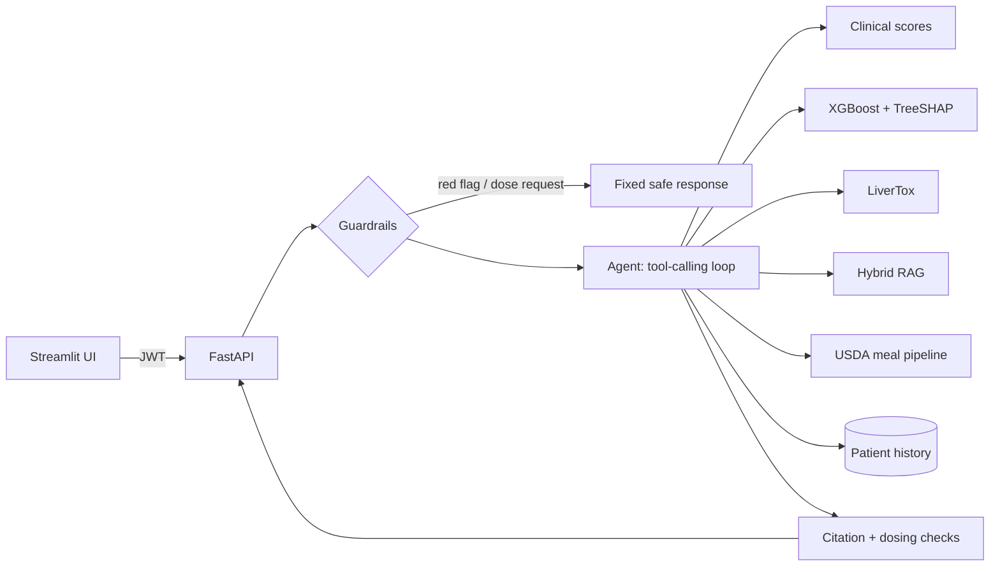

# Liver Buddy

**A grounded, evaluated AI copilot for fatty liver disease (MASLD).** Liver Buddy turns routine checkup
numbers, lab reports, meals and medicine lists into guideline-backed guidance. The language model only
routes, extracts and explains. Every score, probability, nutrient value and drug-risk grade is computed by
code from validated formulas, a trained model or curated public data, and every medical claim cites the
clinical guideline it came from.

> Educational project, not a medical device. It never diagnoses or prescribes, and safety-critical
> messages are handled by fixed rules before any AI runs.

## Results

All numbers are measured by `liverbuddy eval` and the training pipeline. Full tables are in
**[docs/EVALS.md](docs/EVALS.md)** and the risk model is documented in **[docs/MODEL_CARD.md](docs/MODEL_CARD.md)**.
Model-dependent results use a local Qwen2.5-7B and nomic-embed-text on a laptop RTX 4060.

| Component | Result |
|---|---|
| **Liver-fat risk model** (XGBoost, NHANES, n = 7,094) | Held-out AUROC **0.839** (95% CI 0.817-0.860). Beats the Fatty Liver Index (0.821) on the same rows by +0.019 (CI +0.009 to +0.029) |
| **Liver-stiffness risk model** | Held-out AUROC **0.798** (0.757-0.835). The NAFLD Fibrosis Score gets 0.693 on the same label (see the model card caveat on FIB-4) |
| **Hybrid retrieval** (32 gold questions) | hit@3 **93.8%** vs 84.4% for dense-only and BM25-only. MRR 0.823 vs 0.716 / 0.751 |
| **Grounded answers** | **100%** key-fact accuracy when answering, 93.8% answer rate, 90% abstention on out-of-scope questions, **0** invented citations shown |
| **Nutrition grounding** (Nutrition5k, 40 dishes) | LLM re-ranking cuts dish calorie error from 174.6 to **66.7 kcal MAE** (-62%). Median error 14.2% with true portions |
| **Medicine lookup** (909 queries) | **99.4%** top-1 accuracy across generic, misspelt, brand and Indian-brand names. 0% false matches on non-drug text |
| **Safety guardrails** | **90.9%** on a blind held-out set (first run), 100% after fixing both misses. Escalation recall is gated at 100% in CI |
| **Copilot agent** (15 scenarios) | **93.3%** task success, up from 73.3% after an eval-driven fix (development-set number) |

## What it does

| Feature | How it works | Grounded in |
|---|---|---|
| **Liver scores** | FIB-4 (age-adjusted), NAFLD Fibrosis Score, Fatty Liver Index, HSI, APRI, the 5 MASLD criteria, MASLD/MetALD alcohol ranges | Published formulas, EASL-EASD-EASO 2024 stepwise pathway |
| **ML risk estimate** | XGBoost predicting liver fat (CAP >= 274 dB/m) and raised stiffness (LSM >= 8 kPa), with per-patient TreeSHAP drivers and a no-labs fallback model | 7,094 adults with FibroScan, NHANES 2017-2020 |
| **Copilot agent** | Tool-calling loop over 7 tools (scores, risk, drugs, guidelines, meals, history, trends); verifies citations; nudges itself to ground answers | Local Qwen2.5-7B via Ollama, or Gemini |
| **Guideline Q&A** | Hybrid retrieval (dense + BM25 + RRF) with verified `[n]` citations; abstains when the evidence is missing | AASLD 2023 guidance, EASL-EASD-EASO 2024 guideline, NIH LiverTox |
| **Medicine checker** | Brand, generic, misspelt and Indian brand names (Crocin, Dolo 650, Glycomet...) mapped to LiverTox's expert likelihood grade A-E | NIH LiverTox (1,175 drugs) |
| **Meal analyser** | The LLM lists foods and grams (text or photo); a USDA match is chosen by hybrid search plus LLM re-rank; a transparent rule-based liver-diet score | USDA FoodData Central (7,788 foods) |
| **Lab-report reader** | PDF or text, Indian and SI formats (lakh/cumm, mmol/L, g/L, IFCC HbA1c), rules first with range-checked LLM fallback, then scores | Unit-normalised to the score formulas |
| **Safety layer** | Emergency, urgent, crisis (Tele-MANAS 14416) and dose-request routing with clause-scoped negation; an output filter for dosing instructions | Deterministic rules, gated in CI |

## Architecture



More detail, including the request lifecycle and data licences, is in **[docs/ARCHITECTURE.md](docs/ARCHITECTURE.md)**.

## Quick start

Requires Python 3.11+, [uv](https://docs.astral.sh/uv/) and [Ollama](https://ollama.com) (or a Gemini key).

```bash
uv venv && uv pip install -e ".[ui,dev]"
liverbuddy pull-models        # qwen2.5:7b + nomic-embed-text (add --vision for meal photos)
liverbuddy download           # ~250 MB of public data: NHANES, LiverTox, USDA, guidelines, Nutrition5k metadata
liverbuddy build-index        # drug + food tables, RAG indexes (about 2 min on a laptop GPU)
liverbuddy serve              # API on :8000, docs at /docs
liverbuddy ui                 # UI on :8501
```

Optional: `liverbuddy train` retrains the risk models (trained models are committed), `liverbuddy eval`
reruns the evaluation suites, and `pytest` runs the tests. With Docker: `docker compose --profile setup run --rm setup`
then `docker compose up`. A synthetic lab report for trying the upload is in
`tests/fixtures/sample_lab_report.pdf`.

## Engineering notes

- **Numbers never come from the LLM.** Scores are pure functions with unit tests against the published
  equations. Nutrients are USDA per-100 g values times grams. Drug grades are parsed from LiverTox.
- **Structured output everywhere.** Every LLM call that feeds code uses JSON-schema output validated by
  Pydantic, and validation errors are fed back for repair.
- **Citations are enforced, not requested.** Answers that cite passages never retrieved, or cite nothing,
  are withheld. The agent strips unknown `[n]` markers and reports how many it caught.
- **Provider-agnostic.** The same interface wraps Ollama (fully offline), Gemini and a scripted fake LLM that
  makes the agent, RAG and API logic testable in CI without a model server.
- **Observability.** Every LLM call, tool call and retrieval is a traced span with latency and token counts,
  exposed at `/metrics/llm`.
- **Honest evaluation.** The model card states that the fibrosis comparison with FIB-4 is not like-for-like.
  Safety rules are scored on a held-out set separate from the one used for tuning. Every model-dependent metric
  records the model that produced it.

## Project layout

```
src/liverbuddy/
  scoring/      clinical scores, MASLD criteria, meal diet score
  ml/           NHANES cohort, XGBoost training, TreeSHAP inference
  rag/          JATS parsing, chunking, hybrid index, grounded QA
  drugs/        LiverTox table, lookup, INN/Indian-brand aliases
  nutrition/    USDA matcher, meal pipeline
  labs/         lab-report extraction
  safety/       guardrails
  agent/        tools + tool-calling copilot
  llm/          Ollama, Gemini, fake providers; structured output
  api/          FastAPI app
  evals/        evaluation harness
app/            Streamlit UI
evals/datasets/ gold sets: guideline QA, safety (regression + held-out), agent scenarios
docs/           MODEL_CARD.md, EVALS.md, ARCHITECTURE.md
legacy/         original 2025 hackathon prototype, kept for reference
```

## History

This began as a first-year solo hackathon project: a Streamlit app that sent form inputs to an LLM and
displayed whatever came back, with no grounding, no evaluation and some hard-coded metrics. v2 is a ground-up
rebuild around one principle: an AI health tool should compute what can be computed, cite what it claims,
refuse what it shouldn't answer, and measure all of it. The original code is preserved in `legacy/`.

## Limitations

- Not validated for clinical use. The risk model is trained on one US cohort (unweighted NHANES) and its
  calibration in South Asian populations is unknown.
- Meal portions are estimated by an LLM. See the Nutrition5k results for the size of that error.
- The guideline corpus covers two guidelines plus LiverTox; questions outside them are deliberately refused.
- The default local model (Qwen2.5-7B) is small. Larger models improve the agent and RAG metrics, and the eval
  suite makes that comparison one command.

## Licence

MIT for the code. Data sources keep their own licences (see [docs/ARCHITECTURE.md](docs/ARCHITECTURE.md)).
Guideline texts are downloaded at build time and not redistributed.
