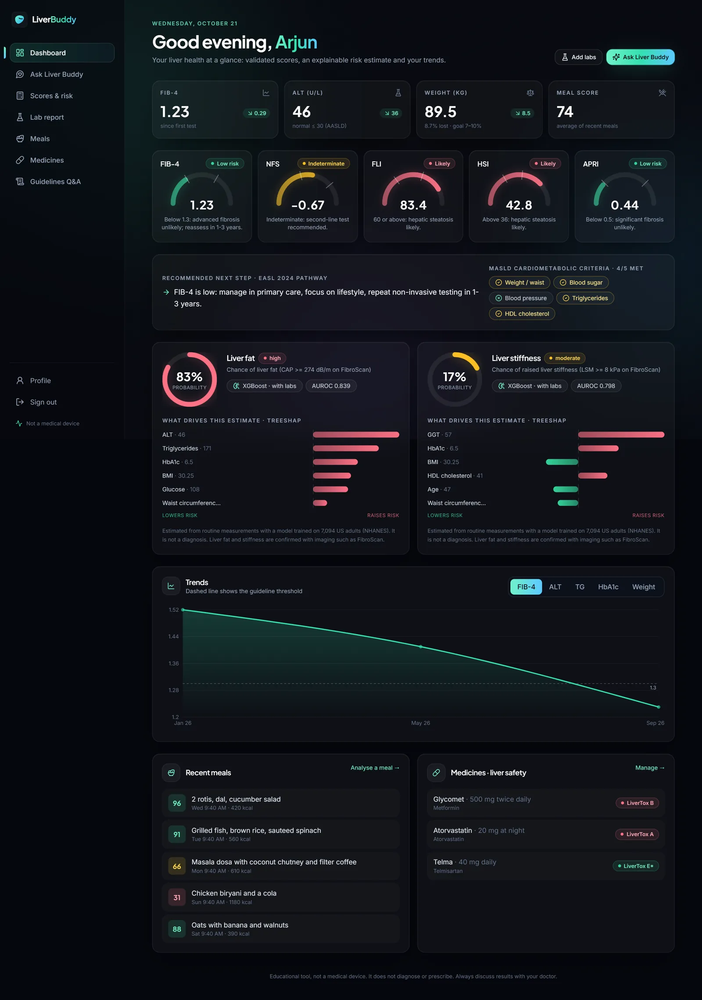
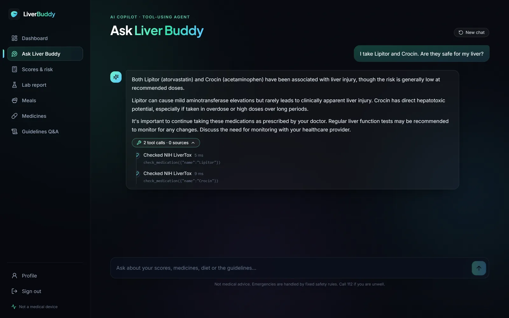
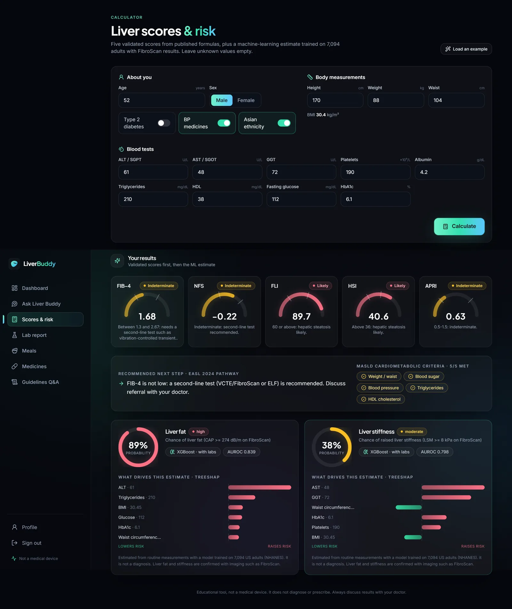
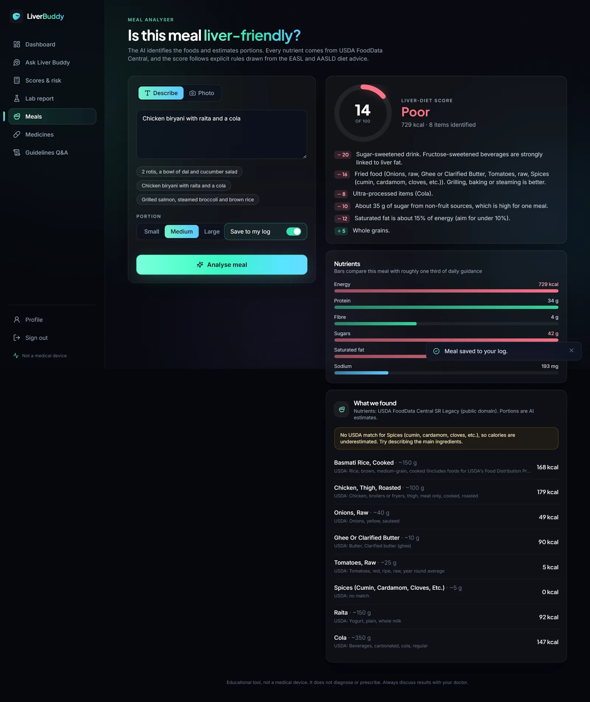
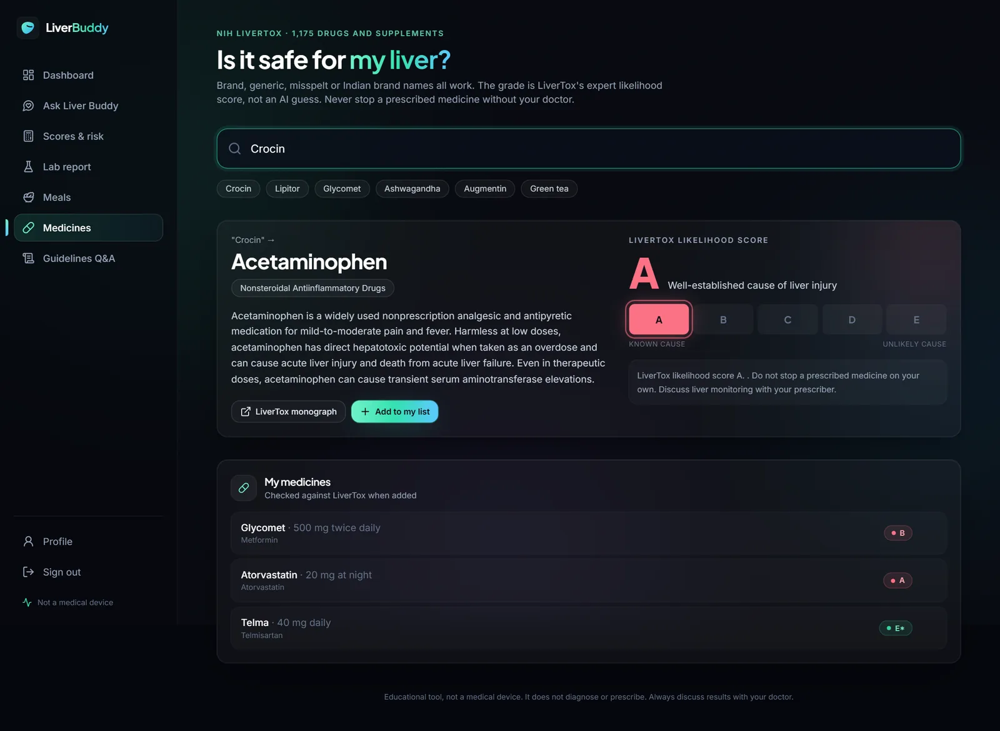
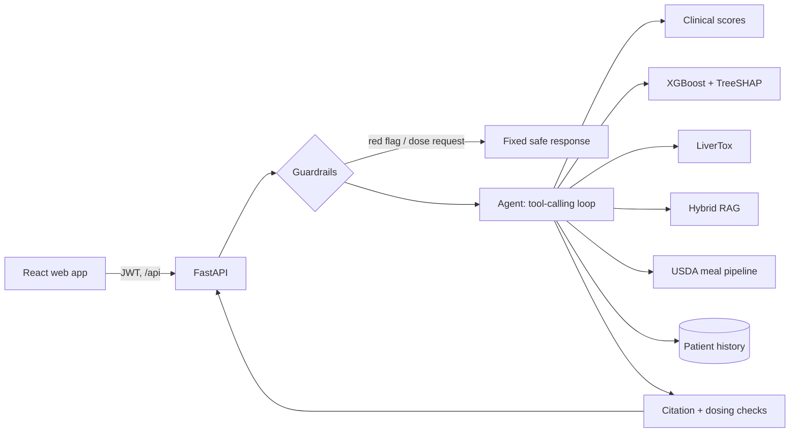

# Liver Buddy

[](https://github.com/akhilll0305/liverbuddy/actions/workflows/ci.yml)


**A grounded, evaluated AI copilot for fatty liver disease (MASLD) that runs fully offline on open models.**

Liver Buddy turns routine checkup numbers, lab reports, meals and medicine lists into guideline-backed
guidance. The language model only routes, extracts and explains. Every score, probability, nutrient value
and drug-risk grade is computed by code from published formulas, a trained model or curated public data.
Every medical claim cites the guideline passage it came from, and citations are checked in code.

> Educational project, not a medical device. It never diagnoses or prescribes, and red-flag messages are
> handled by fixed rules before any AI runs.



## Contents

- [Results](#results)
- [What it does](#what-it-does)
- [How it works](#how-it-works)
- [Design decisions](#design-decisions)
- [What the evaluations caught](#what-the-evaluations-caught)
- [Run it locally](#run-it-locally)
- [Project layout](#project-layout)
- [Limitations](#limitations)

## Results

Every number is produced by `liverbuddy eval` or the training pipeline and stored in
[`evals/results/latest.json`](evals/results/latest.json). Full tables: **[docs/EVALS.md](docs/EVALS.md)**.
Risk model details: **[docs/MODEL_CARD.md](docs/MODEL_CARD.md)**. Model-dependent results use a local
Qwen2.5-7B and nomic-embed-text on a laptop RTX 4060.

| Component | Result |
|---|---|
| **Liver-fat risk model** (XGBoost, NHANES, n = 7,094) | Held-out AUROC **0.839** (95% CI 0.817-0.860). Beats the Fatty Liver Index (0.821) on the same patients by +0.019 (CI +0.009 to +0.029) |
| **Liver-stiffness risk model** | Held-out AUROC **0.798** (0.757-0.835) vs 0.693 for the NAFLD Fibrosis Score on the same label (not a like-for-like comparison, see the model card) |
| **Hybrid retrieval** (32 gold questions) | hit@3 **93.8%** vs 84.4% for dense-only and for BM25-only. MRR 0.823 vs 0.716 / 0.751 |
| **Grounded answers** | **100%** key-fact accuracy when answering, 93.8% answer rate, 90% abstention on out-of-scope questions, **0** invented citations shown |
| **Nutrition grounding** (Nutrition5k, 40 dishes) | LLM re-ranking of USDA matches cuts dish calorie error from 174.6 to **66.7 kcal MAE** (-62%) |
| **Medicine lookup** (909 queries) | **99.4%** top-1 accuracy across generic, misspelt, brand and Indian-brand names. 0% false matches on non-drug text |
| **Safety guardrails** | **90.9%** on the first blind run of a held-out set. Escalation recall is a hard CI gate at 100% |
| **Copilot agent** (15 scenarios) | **93.3%** task success, up from 73.3% after an eval-driven fix (development-set number) |

## What it does

| Dashboard and copilot | Scores and ML risk with TreeSHAP |
|---|---|
|  |  |
| **Meal analysis (USDA-grounded)** | **Medicine check (NIH LiverTox)** |
|  |  |

| Feature | How it works | Grounded in |
|---|---|---|
| **Liver scores** | FIB-4 (age-adjusted), NAFLD Fibrosis Score, Fatty Liver Index, HSI, APRI, the 5 MASLD cardiometabolic criteria, MASLD/MetALD alcohol ranges | Published formulas; EASL-EASD-EASO 2024 stepwise pathway |
| **ML risk estimate** | XGBoost predicting liver fat (CAP >= 274 dB/m) and raised stiffness (LSM >= 8 kPa), with per-patient TreeSHAP drivers and a no-labs fallback model | 7,094 adults with FibroScan, NHANES 2017-2020 |
| **Copilot agent** | Tool-calling loop over 7 tools (scores, risk, medicines, guidelines, meals, history, trends) that verifies citations and insists on grounding | Local Qwen2.5-7B via Ollama, or Gemini |
| **Guideline Q&A** | Hybrid retrieval (dense + BM25 + reciprocal rank fusion) with verified `[n]` citations; abstains when evidence is missing | AASLD 2023, EASL-EASD-EASO 2024, NIH LiverTox |
| **Medicine checker** | Brand, generic, misspelt and Indian brand names (Crocin, Dolo 650, Glycomet) mapped to LiverTox's expert likelihood grade A-E | NIH LiverTox (1,175 drugs) |
| **Meal analyser** | The LLM lists foods and grams from text or a photo; a USDA match is chosen by hybrid search plus LLM re-rank; a transparent rule-based liver-diet score | USDA FoodData Central (7,788 foods) |
| **Lab-report reader** | PDF or text, Indian and SI formats (lakh/cumm, mmol/L, g/L, IFCC HbA1c); rules first, then a range-checked LLM fallback | Unit-normalised to the score formulas |
| **Safety layer** | Emergency, urgent, crisis (Tele-MANAS 14416) and dose-request routing with clause-aware negation; an output filter for dosing instructions | Deterministic rules, gated in CI |

## How it works



A copilot request goes through these steps:

1. **Guardrails first.** Rules route emergencies, crisis messages and dose requests to fixed, safe text.
   The LLM is never called for them, so prompt injection cannot change that behaviour.
2. **Agent loop.** The model sees the question, recent history and 7 JSON-schema tools, and calls tools for
   anything factual. Tool errors go back to the model as data. If it tries to answer a medical question
   without evidence, it is told once to call `search_guidelines` first.
3. **Checks on the way out.** Citation markers that point at passages no tool returned are stripped and
   counted, and sentences that give personal dosing instructions are removed.
4. **Response.** The answer comes back with its citations (deep links into the guidelines), the full tool
   trace and the guardrail decision, so the UI can show exactly what happened.

More detail, including data licences: **[docs/ARCHITECTURE.md](docs/ARCHITECTURE.md)**.

## Design decisions

- **Numbers never come from the LLM.** Scores are pure functions with unit tests against the published
  equations. Nutrients are USDA per-100 g values times grams. Drug grades are parsed from LiverTox.
- **Structured output everywhere.** Every LLM call that feeds code uses JSON-schema output validated by
  Pydantic, and validation errors are sent back to the model for repair.
- **Citations are enforced, not requested.** Guideline answers that cite passages never retrieved, or cite
  nothing, are withheld. Retrieval with low similarity abstains before the LLM is called.
- **Hybrid retrieval.** Dense embeddings catch paraphrases and BM25 catches exact clinical terms ("FIB-4",
  "resmetirom"). Fusing them with RRF beat either one alone on the gold set.
- **Provider-agnostic.** One interface wraps Ollama (fully offline, the default), Gemini, and a scripted fake
  LLM that makes the agent, RAG and API logic testable in CI without a model server.
- **Observability.** Every LLM call, tool call and retrieval is a traced span with latency and token counts,
  summarised at `/api/metrics/llm`.
- **Safe to expose.** Optional per-client rate limiting (`LB_RATE_LIMIT_PER_MINUTE`) on every endpoint that
  calls the model or creates an account, so a public instance cannot exhaust the GPU.

## What the evaluations caught

- **Agent grounding.** The baseline agent scored 73.3% task success because Qwen-7B often answered medical
  questions from memory. Requiring an evidence tool before answering raised it to 93.3%.
- **Blind safety set.** The first run of the held-out safety set scored 90.9% and missed "coffee-ground"
  vomit and "I don't want to live anymore". Both were fixed and moved into the regression set.
- **Code review.** A later review found phrasings neither set covered. A hedge before a comma ("Not sure if
  this is serious, I'm vomiting blood") hid red flags, and diet questions ("How much alcohol can I have?")
  were refused as dose requests. Both were fixed, with tests and regression cases.
- **Honest comparisons.** The model card states that the fibrosis comparison with FIB-4 is not
  like-for-like, and every model-dependent metric records the model that produced it.

## Run it locally

Requires Python 3.11+, [uv](https://docs.astral.sh/uv/), Node.js 20+ and [Ollama](https://ollama.com)
(or a Gemini API key).

```bash
uv venv && uv pip install -e ".[dev]"
liverbuddy pull-models        # qwen2.5:7b + nomic-embed-text (add --vision for meal photos)
liverbuddy download           # ~250 MB of public data: NHANES, LiverTox, USDA, guidelines, Nutrition5k
liverbuddy build-index        # drug + food tables and RAG indexes (about 2 min on a laptop GPU)
cd web && npm install && npm run build && cd ..
liverbuddy serve              # http://localhost:8000 (API docs at /api/docs)
```

Click **Explore the live demo** on the landing page to load a demo patient with nine months of history.
A synthetic lab report for trying the upload is in `tests/fixtures/sample_lab_report.pdf`.

| Command | What it does |
|---|---|
| `liverbuddy ui` | React dev server with hot reload on :5173, proxied to the API |
| `liverbuddy train` | Retrain the risk models and regenerate the model card (trained models are committed) |
| `liverbuddy eval [suite ...]` | Run evaluation suites: `safety`, `ml`, `drugs`, `retrieval`, `rag`, `nutrition`, `agent` |
| `liverbuddy traces` | Latency and token summary from the trace log |
| `pytest` / `ruff check src tests` | Unit tests (no model server needed) and lint |

With Docker: `docker compose --profile setup run --rm setup` once, then `docker compose up` and open
http://localhost:8000. Settings use the `LB_` prefix; see [`.env.example`](.env.example).

## Project layout

```
src/liverbuddy/
  scoring/      clinical scores, MASLD criteria, meal diet score
  ml/           NHANES cohort, XGBoost training, TreeSHAP inference
  rag/          JATS XML parsing, chunking, hybrid index, grounded QA
  drugs/        LiverTox table, fuzzy lookup, INN and Indian-brand aliases
  nutrition/    USDA food matcher, meal pipeline
  labs/         lab-report extraction and unit normalisation
  safety/       input and output guardrails
  agent/        tools and the tool-calling copilot
  llm/          Ollama, Gemini and fake providers; structured output
  api/          FastAPI app and the production server that also serves the UI
  evals/        evaluation harness
web/            React + TypeScript UI (Vite, Tailwind, Framer Motion, Recharts)
tests/          106 unit tests, all runnable offline
evals/          gold datasets (guideline QA, safety regression + held-out, agent scenarios) and results
artifacts/      trained risk models (indexes are built locally and not committed)
docs/           model card, evaluation tables, architecture, screenshots
```

CI runs lint, the unit tests, the deterministic eval suites with a hard gate on safety escalation recall,
a typecheck and build of the web app, and a Docker build with a smoke test.

## Limitations

- Not validated for clinical use. The risk model is trained on one US cohort (unweighted NHANES), and its
  calibration in South Asian populations is unknown.
- Meal portions are estimated by an LLM. The Nutrition5k results show the size of that error.
- The guideline corpus covers two guidelines plus LiverTox. Questions outside them are deliberately refused.
- The guardrails are rules. They are predictable and testable, but phrasings outside the test sets can still
  be missed, which is why they are evaluated on a held-out set.
- The default local model (Qwen2.5-7B) is small. Larger models improve the agent and RAG metrics, and the eval
  suite makes that comparison one command.

## History

This began as a first-year solo hackathon project: a Streamlit app that sent form inputs to an LLM and
displayed whatever came back, with no grounding, no evaluation and some hard-coded metrics. v2 is a ground-up
rebuild around one principle: an AI health tool should compute what can be computed, cite what it claims,
refuse what it shouldn't answer, and measure all of it. The original prototype is preserved in
[git history](https://github.com/akhilll0305/liverbuddy/tree/a07d02d/legacy).

## Licence

MIT for the code. Data sources keep their own licences (see [docs/ARCHITECTURE.md](docs/ARCHITECTURE.md)).
Guideline texts are downloaded at build time and not redistributed.
