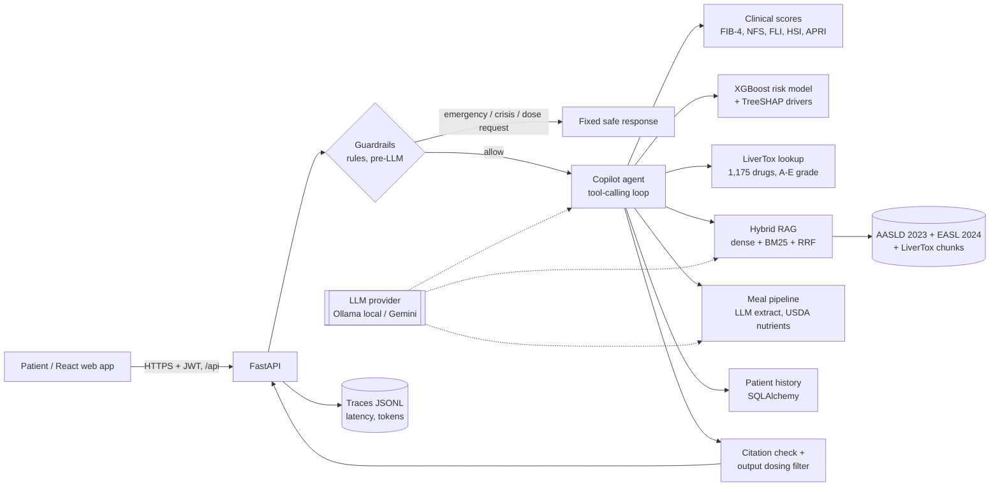

# Architecture

The design rule: **the LLM never produces a number or a safety decision.** It routes, extracts and explains.
Scores, probabilities, nutrients and drug-risk grades come from code and curated public data, so they can be
tested, reproduced and cited.

## Components

| Module | Responsibility | Key decisions |
|---|---|---|
| `scoring/clinical.py` | FIB-4, NFS, FLI, HSI, APRI, the 2023 MASLD cardiometabolic criteria, MASLD/MetALD alcohol ranges | Published formulas and cut-offs, including the age-adjusted FIB-4 threshold of 2.0 at 65+; reports missing inputs instead of guessing |
| `scoring/diet.py` | Meal liver-diet score | Transparent point rules mapped to guideline diet advice; every point carries a reason |
| `ml/` | NHANES cohort, XGBoost training, inference | MASLD-appropriate exclusions; bootstrap CIs; baseline comparison on identical rows; exact TreeSHAP via `pred_contribs`; a no-labs fallback model |
| `rag/jats.py`, `rag/corpus.py` | Parse PMC/Bookshelf XML into section-aware chunks | Floating "Guidance statement" boxes attached to the right section; recursive splitting under a hard size limit; contextual chunk headers |
| `rag/index.py` | Hybrid retrieval | Sparse BM25 and dense cosine fused with RRF (k=60); float16 embeddings on disk; guard against embedding-model mismatch |
| `rag/qa.py` | Grounded answers | Abstain on low similarity before the LLM call; JSON-schema output; withhold answers with invented or missing citations |
| `drugs/` | LiverTox drug table and lookup | Likelihood grade parsed from the monographs; INN and Indian-brand aliases; short names need an exact match |
| `nutrition/` | USDA matching and meal analysis | Head-noun-aware hybrid matcher; batched LLM re-rank over 8 candidates; nutrients = USDA per-100 g x grams |
| `labs/extract.py` | Lab-report parsing | Rules first, with unit normalisation (lakh/cumm, mmol/L, g/L, IFCC HbA1c); the LLM only fills gaps inside plausible ranges |
| `safety/guardrails.py` | Input routing and output filtering | Clause-scoped negation; crisis > emergency > urgent > dosing priority; output filter strips personal dosing instructions |
| `agent/` | Tool-calling copilot | 7 JSON-schema tools; at most 6 steps; a grounding nudge if the model answers from memory; citation numbering shared across the turn |
| `llm/` | Provider abstraction | Ollama (offline, default), Gemini, and a scripted fake for tests; structured output with validation-error repair loop |
| `web/` | React + TypeScript single-page app | Thin typed client over `/api`; Framer Motion animations; Recharts trends; served by FastAPI in production (single port), Vite proxy in development |
| `observability.py` | Tracing | Per-request spans (LLM, tool, retrieval) with latency and tokens; PII redaction helper; `/metrics/llm` p50/p95 |
| `evals/` | Evaluation harness | Deterministic suites gate CI; model suites record which model produced each number |

## Data sources (all public)

| Source | Use | Licence |
|---|---|---|
| NHANES 2017-March 2020 (CDC) | Risk-model training and evaluation | Public domain |
| AASLD 2023 Practice Guidance (PMC10735173) | RAG corpus | Author manuscript via PMC; fetched at build time, not redistributed |
| EASL-EASD-EASO 2024 MASLD guideline, executive summary (PMC11519095) | RAG corpus | Open access; fetched at build time |
| NIH LiverTox (NBK547852) | Drug hepatotoxicity table and RAG corpus | Public domain |
| USDA FoodData Central SR Legacy | Nutrient values | Public domain (CC0) |
| Nutrition5k (Google Research) | Nutrition evaluation | CC BY 4.0 |

## Request lifecycle: `/copilot`

1. `check_input` routes the message. Emergencies, crisis messages and dose requests return fixed text and the
   LLM is never called.
2. The agent loop sends the system prompt, the last 6 history turns, the question and the tool schemas.
3. Each tool call runs inside a traced span. Errors are returned to the model as data and never raise.
4. If the first reply uses no tools, the agent is told once to ground the answer with `search_guidelines`.
5. `[n]` markers are normalised. Markers without a matching returned passage are stripped and reported.
6. `check_output` removes any sentence that gives personal dosing instructions.
7. The response carries the answer, citations (with deep links), the tool trace and guardrail metadata.
