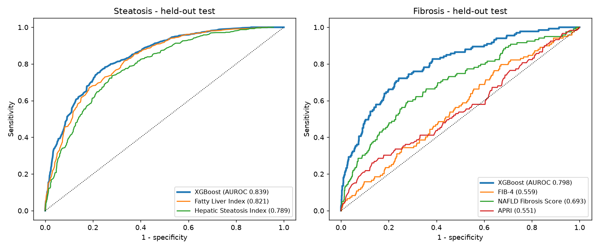
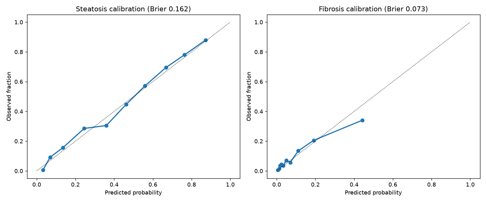

# Model card: NHANES MASLD risk models

_Generated by `liverbuddy train`. Do not edit by hand._

## Intended use
Educational risk estimate of hepatic steatosis (CAP >= 274 dB/m) and clinically significant liver stiffness (LSM >= 8 kPa) from routine measurements. **Not a diagnostic device.** It is meant to explain *why* a person might discuss non-invasive testing with their doctor.

## Data
NHANES 2017-March 2020 pre-pandemic cycle (CDC, public domain). Labels come from vibration-controlled transient elastography. Cohort flow:

| Step | n |
|---|---|
| elastography participants | 10,409 |
| after complete exam | 9,023 |
| after adults only | 7,768 |
| after cap lsm present | 7,767 |
| after viral hepatitis excluded | 7,512 |
| after significant alcohol excluded | 7,094 |
| final cohort | 7,094 |
| fibrosis cohort reliable lsm | 7,094 |

Exclusions: incomplete elastography, age < 18, viral hepatitis (HCV RNA+ or self-reported HBV/HCV), and alcohol intake of 140 g/week or more (women) or 210 g/week or more (men), which falls outside the MASLD alcohol range.

## Results (held-out 20% test split, 95% bootstrap CI)

| Model | Features | AUROC | AUPRC | Brier | Sens / Spec @ Youden |
|---|---|---|---|---|---|
| steatosis (full) | 15 | 0.839 (0.817-0.860) | 0.776 | 0.162 | 0.73 / 0.79 |
| steatosis (basic) | 6 | 0.806 (0.783-0.827) | 0.719 | 0.178 | 0.73 / 0.72 |
| fibrosis (full) | 15 | 0.798 (0.757-0.835) | 0.369 | 0.073 | 0.78 / 0.65 |
| fibrosis (basic) | 6 | 0.761 (0.714-0.804) | 0.350 | 0.074 | 0.75 / 0.63 |

### Against established clinical scores (same test rows)

| Task | Score | AUROC (95% CI) | Model minus score, delta AUROC (95% CI) |
|---|---|---|---|
| steatosis | Fatty Liver Index | 0.821 (0.798-0.843) | +0.019 (+0.009 to +0.029) |
| steatosis | Hepatic Steatosis Index | 0.789 (0.764-0.813) | +0.051 (+0.035 to +0.066) |
| fibrosis | FIB-4 | 0.559 (0.508-0.612) | +0.241 (+0.180 to +0.306) |
| fibrosis | NAFLD Fibrosis Score | 0.693 (0.640-0.742) | +0.107 (+0.060 to +0.155) |
| fibrosis | APRI | 0.551 (0.490-0.609) | +0.249 (+0.186 to +0.317) |

### Subgroups (full models)

| Task | Subgroup | n | AUROC |
|---|---|---|---|
| steatosis | female | 717 | 0.820 |
| steatosis | male | 691 | 0.854 |
| steatosis | age<50 | 704 | 0.880 |
| steatosis | age>=50 | 704 | 0.786 |
| steatosis | BMI<25 (lean) | 396 | 0.848 |
| steatosis | BMI>=25 | 1012 | 0.785 |
| fibrosis | female | 723 | 0.826 |
| fibrosis | male | 685 | 0.774 |
| fibrosis | age<50 | 698 | 0.818 |
| fibrosis | age>=50 | 710 | 0.772 |
| fibrosis | BMI<25 (lean) | 387 | 0.722 |
| fibrosis | BMI>=25 | 1021 | 0.793 |

## Limitations
- Analysis is unweighted. NHANES survey weights are not applied, so prevalence is not a US population estimate.
- CAP and LSM are imperfect reference standards. Biopsy is the gold standard.
- Triglycerides and glucose come from non-fasting serum biochemistry.
- One US cohort only. Calibration in other populations (for example South Asian patients) is unknown and likely to differ.
- Race and ethnicity are deliberately excluded as features.
- The fibrosis comparison is not like-for-like. FIB-4, NFS and APRI were designed to detect *advanced* fibrosis (F3-F4), while the label here is LSM >= 8 kPa, a broader rule-out threshold. The model is optimised for this label and the scores are not, so the large delta overstates any clinical advantage. FIB-4 stays the guideline first-line test, and the app always shows it.
- The basic variant (no blood tests) is intended for people without recent labs. Its accuracy is lower.
